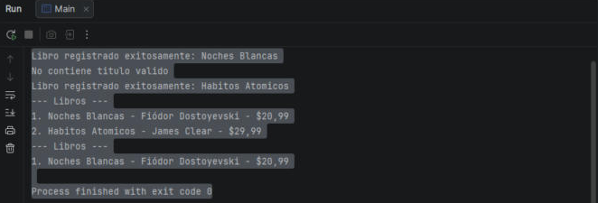
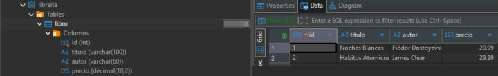
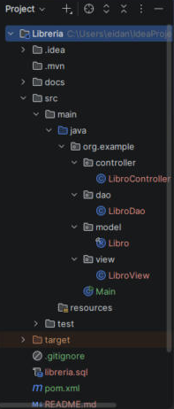

# 📚 Librería — JDBC con patrón MVC + DAO

Aplicación de consola en **Java 21** que gestiona los libros de una librería guardados en **MySQL**, usando **JDBC** puro y una arquitectura **MVC con DAO**.

Proyecto de práctica de la formación de desarrollo de software en **Campuslands** (Sesión 18: JDBC con patrón MVC).

---

## ✨ Funcionalidades

- **Registrar** un libro (título, autor y precio).
- **Listar** todos los libros, ordenados por id.
- **Buscar** libros por autor.
- **Validar** los datos antes de tocar la base de datos: rechaza títulos vacíos, precios menores o iguales a 0 y búsquedas sin autor.

---

## 🛠️ Tecnologías

| Tecnología | Uso |
|---|---|
| Java 21 | Lenguaje (records, try-with-resources) |
| Maven | Gestión de dependencias |
| MySQL | Base de datos |
| JDBC (`java.sql`) | Conexión y consultas desde Java |
| `mysql-connector-j` | Driver de MySQL para JDBC |
| IntelliJ IDEA | IDE |
| DBeaver CE | Cliente de base de datos |

---

## 🏗️ Arquitectura

El código está dividido en capas. Cada una tiene una sola responsabilidad y solo habla con la de al lado.

```
Main ──órdenes──► Controlador ──► DAO ──► MySQL
                      │            │
                      │     devuelve Libro / List<Libro>
                      ▼
                    Vista ──► consola
```

| Capa | Clase | Responsabilidad |
|---|---|---|
| **Modelo** | `Libro` | Representa un libro. Es un `record` inmutable que viaja entre capas. |
| **DAO** | `LibroDao` | Única clase con SQL y JDBC. No imprime nada y declara `SQLException` con `throws`. |
| **Vista** | `LibroView` | Solo muestra mensajes y listas por consola. |
| **Controlador** | `LibroController` | Valida los datos, llama al DAO, maneja los errores y le pasa el resultado a la vista. |
| **Main** | `Main` | Arma las piezas y ejecuta el flujo de ejemplo. |

```
src/main/java/org/example
├── Main.java
├── model/        → Libro.java
├── dao/          → LibroDao.java
├── view/         → LibroView.java
└── controller/   → LibroController.java
```

### Buenas prácticas aplicadas

- **`PreparedStatement` con `?`** en todas las consultas, para evitar la inyección SQL.
- **try-with-resources** para cerrar automáticamente `Connection`, `PreparedStatement` y `ResultSet`.
- **Validación en el controlador**: los datos inválidos nunca llegan a MySQL.
- **Errores manejados en un solo lugar**: el DAO propaga la `SQLException` y el controlador la convierte en un mensaje para el usuario.
- **Credenciales fuera del código**: la contraseña se lee de la variable de entorno `DB_PASS`.

---

## 🚀 Cómo ejecutarlo

### 1. Requisitos

- JDK 21 o superior
- MySQL 8.4 o superior en `localhost:3306`
- IntelliJ IDEA (o Maven desde la terminal)

### 2. Crear la base de datos

Ejecuta el script [`libreria.sql`](libreria.sql) en MySQL (por ejemplo, desde DBeaver).

### 3. Configurar la contraseña

El programa se conecta como `root` y lee la contraseña de la variable de entorno **`DB_PASS`**.

En IntelliJ: **Run → Edit Configurations... → Main → Environment variables**:

```
DB_PASS=tu_contraseña
```

### 4. Ejecutar

Abre el proyecto en IntelliJ, deja que Maven descargue las dependencias y ejecuta `Main`.

---

## 📸 Capturas

### Ejecución en consola



```
Libro registrado exitosamente: Noches Blancas
No contiene titulo valido
Libro registrado exitosamente: Habitos Atomicos
--- Libros ---
1. Noches Blancas - Fiódor Dostoyevski - $20,99
2. Habitos Atomicos - James Clear - $29,99
--- Libros ---
1. Noches Blancas - Fiódor Dostoyevski - $20,99
```

El libro sin título se rechaza en el controlador, por eso nunca llega a la base de datos y los ids quedan seguidos (1 y 2).

### Datos guardados en MySQL



### Estructura del proyecto



---

## 📖 Lo que aprendí

- Cómo conectarse a MySQL desde Java con JDBC: driver, `Connection`, `PreparedStatement` y `ResultSet`.
- La diferencia entre `executeUpdate()` (INSERT, UPDATE, DELETE) y `executeQuery()` (SELECT).
- Por qué los parámetros de JDBC empiezan en 1 y no en 0.
- Cómo separar responsabilidades con MVC + DAO, y por qué el DAO usa `throws` mientras el controlador usa `try/catch`.
- Cuándo usar un `record` (datos que no cambian) y cuándo una clase normal.

---

## 👤 Autor

**Eidan Alexander Carreño Cuadros**
GitHub: [@Eidan210](https://github.com/Eidan210) · Portafolio: [eidan210.github.io/portafolio-junior](https://eidan210.github.io/portafolio-junior/)
